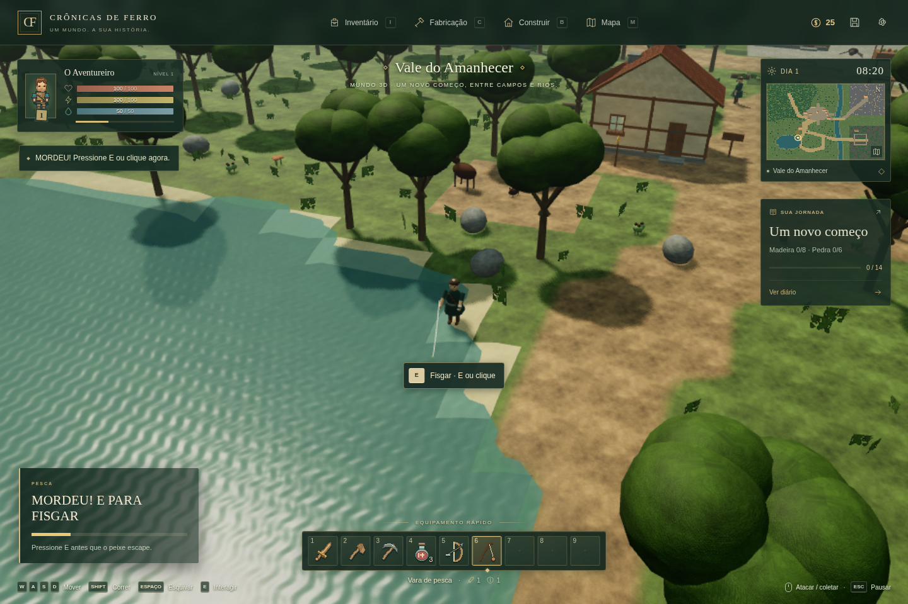

# Crônicas de Ferro — edição 3D

RPG medieval para navegador, em português. O mundo agora usa **Three.js e WebGL 2**, com terreno em relevo, modelos tridimensionais, materiais originais com mapas de normal e rugosidade, sombras, água animada e câmera giratória. A direção de arte é 3D estilizada com materiais naturais.

Os sistemas de inventário, fabricação, equipamentos, comércio, missões e salvamento da edição 2D foram mantidos. Os saves existentes continuam usando os mesmos itens, IDs, coordenadas e chave do navegador.



Captura real da partida, no modo de qualidade reduzida usado pelo renderizador por software dos testes.

## Executar

Requer Node.js 22.12+ ou 24 LTS, npm e navegador moderno com WebGL 2. Ative a aceleração de hardware do navegador para melhor desempenho. A instalação baixa dependências npm; a partida usa apenas arquivos locais, sem login ou APIs externas.

```sh
npm install
npm run dev
```

Abra no navegador o endereço indicado pelo Vite. Para distribuir como site estático:

```sh
npm run build
npm run preview
```

Sirva o conteúdo de `dist/` por HTTP, a partir da raiz do site. O save pertence à origem do navegador; trocar domínio ou porta cria outro espaço de salvamento.

## O que mudou em 3D

- Mundo volumétrico com casas enxaimel, telhados, janelas, poço, forjas, bancadas, árvores, rochas, minérios e vegetação.
- Materiais originais de grama, terra, areia, pedra, madeira, casca, telhas, tecido e couro; mapas de normal e rugosidade em 512 × 512.
- Perspectiva com rotação e zoom; movimento relativo à câmera e personagens articulados.
- Sombras direcionais, neblina de distância, ciclo dia/noite e iluminação de tochas.
- Margens rasas, fundo dos lagos e rios, água transparente com ondas, reflexos de luz e anéis na superfície.
- **Entrada na água:** caminhe pela margem. O personagem atravessa trechos rasos e passa a nadar automaticamente quando a profundidade aumenta. Nadar gasta energia; esgotá-la consome fôlego e, depois, vida. Volte ao raso para recuperar-se.
- **Pesca:** vara, linha e bóia visíveis. Espere a mordida e pressione E ou clique dentro da janela de fisgada. O peixe pode escapar. Uma captura bem-sucedida entrega dois peixes ao inventário.
- **Caça:** cervos e coelhos percebem a aproximação e fogem. Javalis podem reagir com ataques. Flechas acertam os animais, consomem munição e geram experiência e loot de carne, couro, presas ou fibras. A carne pode ser assada numa fornalha.

O personagem de uma partida nova começa com espada, machado, picareta, três poções, vara de pesca, arco e doze flechas. Em saves antigos, a vara pode ser fabricada à mão com três madeiras e duas fibras.

## Controles

| Tecla ou mouse | Ação |
| --- | --- |
| WASD ou setas | Mover em relação à câmera |
| Q / R | Girar a câmera |
| Roda do mouse | Aproximar ou afastar |
| Botão do meio + arrastar | Girar e inclinar a câmera |
| Shift | Correr, consumindo energia |
| Mouse + clique esquerdo | Mirar, atacar, usar ferramenta ou posicionar construção |
| Clique direito | Bloquear com escudo; interagir sem escudo |
| Espaço | Esquivar |
| E | Interagir, coletar, lançar a linha ou fisgar |
| 1 | Arma equipada |
| 2 / 3 | Machado / picareta |
| 4 | Consumir poção de cura |
| 5 / 6 | Arco / vara de pesca na barra inicial |
| 1–9 | Selecionar ou usar o atalho correspondente |
| I / C / B | Inventário / fabricação / construção |
| M / J / K | Mapa / missões / habilidades |
| Esc | Cancelar pesca/construção, fechar menu ou pausar |
| F5 ou botão de salvar | Salvar manualmente |

## Testar a aventura

1. Inicie uma partida e experimente mover, girar e aproximar a câmera.
2. Colete árvores e pedras perto de casa com E. Árvores comuns exigem três golpes e rendem seis madeiras; rochas rendem quatro pedras. Ferramentas de ferro são mais eficientes.
3. Fabrique uma bancada em C, usando oito madeiras e quatro pedras. Posicione-a com B num terreno livre próximo. A prévia indica a validade do local.
4. Perto da bancada, fabrique armas e estações. Receitas exigem materiais, estação e nível reais. Organize a mochila, compare e equipe itens em I.
5. Vá até o lago a sudoeste da casa. Entre andando na água, observe a profundidade e volte à margem antes de gastar toda a energia.
6. Na margem, selecione a vara em 6 e pressione E. Quando aparecer **MORDEU**, pressione E ou clique para recolher o peixe. Mover-se cancela a pesca; menus pausam o relógio da fisgada.
7. Selecione o arco em 5, mire em um coelho ou cervo e clique. Aproxime-se dos itens deixados para recolher carne e couro. Fabrique flechas com madeira e pedra quando acabarem.
8. Siga a estrada ao norte até Pedra Alta. Converse com Breno e use a fornalha para assar peixe ou carne e fundir minérios. Use a forja para fabricar equipamento metálico.
9. Construa cabana, baús, cercas, tochas e canteiros. Baús transferem pilhas de itens; canteiros produzem ervas a cada 90 segundos de jogo ativo. Recursos não reaparecem atravessando construções.
10. Explore as minas e as ruínas. Prepare armas, armadura e poções para os inimigos mais fortes e o Guardião.
11. Salve, feche e reabra usando a mesma origem do navegador. Posição, equipamentos, recursos, base, baús, animais derrotados e loot não recolhido são preservados.

## Conteúdo e limites

Há cinco regiões contínuas, oito tipos de inimigos, três tipos de animais de caça, seis NPCs com comércio e diálogos, nove missões, seis habilidades, 63 itens, 41 receitas e 14 estruturas. Espadas, machados, lanças, arcos e cajados possuem diferenças de dano, alcance, velocidade e consumo. Combate inclui recuo, bloqueio, esquiva, invulnerabilidade breve, morte e reaparecimento.

Esta é uma edição inicial em 3D. Modelos e animações são procedurais e compactos. Interiores exploráveis, criação de animais, ataques à base, montarias, facções, clima, árvores de talentos, durabilidade, remapeamento de controles e suporte de toque continuam para expansão. Casas são construções externas com descanso; melhorias modulares de casas existentes ainda estão pendentes.

A qualidade se ajusta automaticamente a renderizadores por software. Para selecionar manualmente, acrescente `?quality=low` ou `?quality=high` ao endereço do jogo. O modo reduzido mantém os mesmos sistemas, com menor resolução interna, sombras mais leves e menos luzes simultâneas.

## Salvamento

O save usa `localStorage`, na chave estável `cronicas-de-ferro.save.v1`. O formato é versão 2, com migrações das versões 0 e 1, validação e backup do último save válido. A conversão para 3D preserva o formato e usa X/Y do mapa como X/Z do terreno. Uma posição que passe a coincidir com geometria sólida pode ser ajustada para casa ao carregar.

Salvamento automático a cada 20 segundos ativos, ao sair da página e em ações importantes. Menus pausam a simulação. O tempo offline não é simulado. A morte preserva itens e cobra 10% das moedas, limitado a 25. Limpar os dados do navegador remove os saves.

## Testes

```sh
npm test
npm run build
npm run test:e2e
```

Os testes de lógica verificam inventário, custos atômicos, economia, receitas, equipamentos, progressão, saves, conectividade, profundidade, energia e a janela de fisgada. A suíte ativa de navegador está em `tests/browser3d.spec.ts`: usa teclado, mouse, projeção da câmera real e menus para verificar água, pesca, caça, construção, combate, comércio e persistência. Teleportes no hook exclusivo de desenvolvimento encurtam os deslocamentos; fixtures isoladas preparam casos de morte e horário.

Os testes usam `/usr/bin/chromium` quando existe. Em outras máquinas, execute `npx playwright install chromium` ou defina `CHROMIUM_PATH`. O runner inicia ou reutiliza o Vite da porta 5173. Os antigos testes de navegador 2D estão arquivados em `tests/legacy-2d.spec.ts` e não compõem a suíte 3D.

## Arquitetura e arte

- `src/main.ts`: inicialização 3D e ligação com a interface.
- `src/three/Game3D.ts`: controles, câmera e coordenação de coleta, construção, combate e persistência.
- `src/three/Terrain3D.ts`: relevo, profundidade, materiais do terreno e água.
- `src/three/Models3D.ts`: modelos articulados e construções.
- `src/three/Scenery3D.ts`: vegetação instanciada por regiões, recursos e estruturas.
- `src/three/Actors3D.ts`: inimigos e animais com percepção, fuga, perseguição, ataques e loot.
- `src/three/Survival.ts`: estados da água e máquina de estados da pesca.
- `src/data/`, `src/systems/GameModel.ts`, `src/systems/SaveSystem.ts`: dados e sistemas preservados.
- `src/ui/`: HUD e menus HTML/CSS.
- `src/legacy2d.ts`, `src/scenes/`, demais sistemas 2D: implementação anterior preservada como referência.
- `public/assets3d/textures/`: materiais 3D originais.
- `public/assets/`: ícones e arte da edição anterior.

`python scripts/generate_materials.py` regenera os materiais 3D e os novos ícones; requer Python, NumPy e Pillow. `scripts/generate_assets.py` preserva o gerador da arte 2D. Nenhuma textura, modelo ou áudio das referências foi copiado. Os modelos são construídos com geometria original e o áudio é sintetizado localmente. Three.js, Phaser e as ferramentas mantêm suas próprias licenças.
